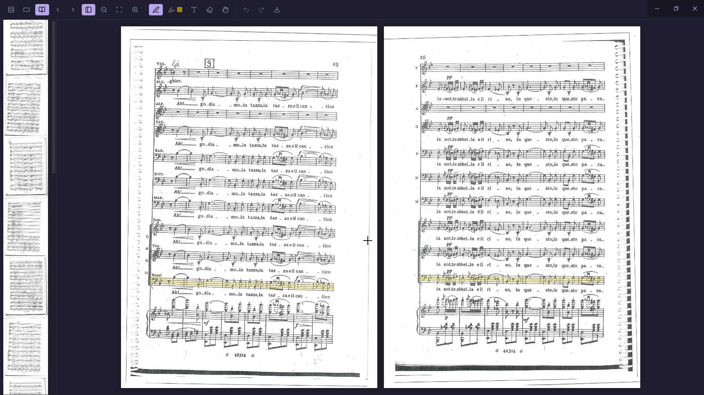

# BetterScore

BetterScore is an Obsidian plugin for reading and annotating PDF sheet music. It is inspired by forScore, with an emphasis on portable, vault-native data.

The original PDF is never modified. BetterScore stores normalized annotation strokes in a versioned `.betterscore.json` sidecar beside the score, making annotations straightforward to sync, back up, and inspect independently of the plugin.



## Current features

- Continuous, single-page, and two-page spread PDF reading
- Viewport-based lazy page rendering with bounded canvas memory
- Incremental continuous startup that loads only the active page geometry before first render
- Mouse, stylus, and Apple Pencil annotation input
- Pressure-sensitive pen
- Semi-transparent yellow marker with a persistent right-click width menu
- Positioned multiline text annotations
- Stroke eraser
- Persistent stroke and precision eraser modes from the Eraser button's right-click menu
- Undo and redo, including keyboard shortcuts
- Automatic sidecar saving
- Serialized, revision-aware saves that flush on background and close
- Compact tuple-based sidecars with live sample filtering and stroke simplification
- PDF fingerprints and automatic sidecar moves when source PDFs are renamed
- A fuzzy BetterScore quick switcher containing every PDF in the vault
- Shared continuous/single/spread viewer state and a mode-aware navigation controller
- Pure, DOM-independent spread pairing and transition functions
- Central Pencil, finger, and mouse input routing policy
- Persistent finger-drawing toggle for touch annotation on iPad
- Page navigation from arrow keys, Page Up/Down, Home/End, and command-palette actions
- Finger swipe and edge-tap page turns in single and spread modes
- Persistent per-score spread pairing correction from the Spread button's right-click menu or command palette
- Bounded neighbor prefetch so paged modes reuse rendered surfaces instead of rerendering every turn
- Adaptive full-document paged caching for small PDFs within explicit source and canvas-memory budgets
- Sharp, centered 50–300% zoom with keyboard shortcuts, Ctrl+wheel, and bounded canvas dimensions
- A lazy, low-resolution thumbnail strip with current-page tracking
- Non-destructive flattened PDF export to a new sibling file
- Explicit memory warning before large flattened exports
- Desktop and mobile support

BetterScore is in active beta development. Its core reader, annotation, navigation, persistence, and export workflows are implemented; physical iPad hardening remains ongoing.

## Install for development

1. Clone this repository to `<vault>/.obsidian/plugins/betterscore`.
2. Run `npm install`.
3. Run `npm run verify`.
4. Enable BetterScore under **Settings → Community plugins** in Obsidian.

Right-click a PDF and choose **Open in BetterScore**, or open a PDF and run **BetterScore: Open active PDF in BetterScore** from the command palette.

## Development

```sh
npm install
npm run verify
```

`npm run verify` runs the TypeScript check, model tests, and production build.

## Rendering architecture

`PageSurface` owns the PDF canvas, ink canvas, pointer listeners, render task, and bitmap cleanup for one mounted page. `PageSurfaceManager` builds continuous, single, and spread layouts from the same cached PDF geometry. Continuous cold-open reads only the active page geometry, creates cheap estimated placeholders for the full scroll range, and corrects each placeholder when its page approaches the viewport. Viewport observation, bounded rendering, and distant-canvas eviction keep the active window small. Paged modes mount only the one or two visible surfaces and fit them to both viewport width and height. Zoom rebuilds those same surfaces sharply while bounding backing-store dimensions. `ThumbnailStrip` has its own lazy, single-task low-resolution queue and releases PDF.js page resources after each render. `NavigationController` owns the shared viewer state and all page transitions, while the score view coordinates annotations, tools, and input adapters without constructing PDF canvases directly.

Flattened export preserves the original PDF and writes `Score.annotated.pdf` (or the next available numbered name). It rasterizes only the transparent annotation layer, at up to 2× resolution, and places that layer over each original PDF page with `pdf-lib`. Because `pdf-lib` holds the source and complete output in memory, BetterScore requires explicit confirmation for large exports (64 MiB on mobile, 192 MiB on desktop).

Run **BetterScore: Show render statistics** from the command palette while a score is active to inspect mounted surfaces, canvases, pixel area, render queues, cached geometries, estimated placeholders, cancellations, and the viewport-centered page.

## Annotation format

For a PDF named `Requiem.pdf`, BetterScore creates `Requiem.betterscore.json`. Coordinates and widths are normalized to the PDF page so annotations remain aligned at different display sizes.

The format is versioned and migrations are handled when sidecars are loaded. Format v5 identifies the source PDF using its size and a replacement fingerprint derived from its first and last 64 KiB. This is an efficient accidental-replacement check, not a full-file content hash. Format v6 stores the score's spread-pairing offset while keeping the current page out of the portable document. A matching fingerprint allows moved files to self-heal their stored path; mismatched content is never allowed to overwrite an existing sidecar silently.

## Roadmap

- [x] Add viewport-based lazy rendering for large scores and mobile memory limits
- [x] Establish shared continuous/single/spread state and one navigation API
- [x] Add a view-mode switch between continuous vertical scrolling and page-by-page flipping
- [x] Add a dual-page spread for landscape screens with correct left/right page pairing
- [x] Preserve the current page in the shared state when switching viewing modes
- [x] Advance dual-page spreads by two pages while allowing single-page correction
- [x] Support toolbar, edge-tap, swipe, and keyboard page turns; pedal input remains later
- [x] Add zoom, thumbnails, and flattened PDF export

## License

BetterScore is free software licensed under the [GNU General Public License v3.0 only](LICENSE).
